

# Live Websites Showcase

### *Every deployed web experience from [risterz](https://github.com/risterz) — verified live, explained, and previewed in one place.*

---

## Quick Directory

| # | Project | Live Website | Host | Source Repo |
| --- | --- | --- | --- | --- |
| 1 | **3D Interactive Portfolio** | [haris-profile.vercel.app](https://haris-profile.vercel.app) | Vercel | [risterz/3d-portfolio](https://github.com/risterz/3d-portfolio) |
| 2 | **COSMOS — Solar System Explorer** | [cosmos-explorer-prz.pages.dev](https://cosmos-explorer-prz.pages.dev) | Cloudflare Pages | [risterz/cosmos-explorer](https://github.com/risterz/cosmos-explorer) |
| 3 | **DONUTVERSE** | [donutverse.pages.dev](https://donutverse.pages.dev) | Cloudflare Pages | [risterz/donutverse](https://github.com/risterz/donutverse) |
| 4 | **Email Dot Generator** | [gmail-dot-generator.netlify.app](https://gmail-dot-generator.netlify.app) | Netlify | [risterz/email-dot-generator](https://github.com/risterz/email-dot-generator) |
| 5 | **Ember & Olive** | [ember-olive-6v6.pages.dev](https://ember-olive-6v6.pages.dev) | Cloudflare Pages | [risterz/ember-olive](https://github.com/risterz/ember-olive) |
| 6 | **Gemini Web Interface** | [gemini-crack.onrender.com](https://gemini-crack.onrender.com) | Render | [risterz/gemini-web-ui](https://github.com/risterz/gemini-web-ui) |
| 7 | **HIV Atlas** | [hiv-atlas.pages.dev](https://hiv-atlas.pages.dev) | Cloudflare Pages | [risterz/hiv-atlas](https://github.com/risterz/hiv-atlas) |
| 8 | **HIV Molecular Lab 3D** | [hiv-molecular-lab-3d.pages.dev](https://hiv-molecular-lab-3d.pages.dev) | Cloudflare Pages | [risterz/hiv-molecular-lab-3d](https://github.com/risterz/hiv-molecular-lab-3d) |
| 9 | **KAFA Sirah** | [kafa-sirah.vercel.app](https://kafa-sirah.vercel.app) | Vercel | [risterz/kafa-sirah](https://github.com/risterz/kafa-sirah) |
| 10 | **KeyThock 3D** | [keythock.pages.dev](https://keythock.pages.dev) | Cloudflare Pages | [risterz/keythock](https://github.com/risterz/keythock) |
| 11 | **SonicShift (MP4 to MP3)** | [sonicshift-mp3.pages.dev](https://sonicshift-mp3.pages.dev) | Cloudflare Pages | [risterz/mp4-to-mp3-converter](https://github.com/risterz/mp4-to-mp3-converter) |
| 12 | **NEOMARKET** | [neomarket-1v5.pages.dev](https://neomarket-1v5.pages.dev) | Cloudflare Pages | [risterz/neomarket](https://github.com/risterz/neomarket) |
| 13 | **Papercraft PDF** | [papercraft-pdf.pages.dev](https://papercraft-pdf.pages.dev) | Cloudflare Pages | [risterz/papercraft-pdf](https://github.com/risterz/papercraft-pdf) |
| 14 | **PixelVault** | [pixelvault-30v.pages.dev](https://pixelvault-30v.pages.dev) | Cloudflare Pages | [risterz/pixelvault](https://github.com/risterz/pixelvault) |
| 15 | **RoomForge 3D** | [roomforge-3d.pages.dev](https://roomforge-3d.pages.dev) | Cloudflare Pages | [risterz/RoomForge-3D](https://github.com/risterz/RoomForge-3D) |
| 16 | **Saukass** | [risterz.github.io/saukazz](https://risterz.github.io/saukazz/) | GitHub Pages | [risterz/saukazz](https://github.com/risterz/saukazz) |
| 17 | **Shuffle Puzzle** | [shuffle-puzzle.harisharraz02.workers.dev](https://shuffle-puzzle.harisharraz02.workers.dev/) | Cloudflare Workers | [risterz/shuffle-puzzle](https://github.com/risterz/shuffle-puzzle) |
| 18 | **Synthwave CSS Generator** | [synthwavecssgen.netlify.app](https://synthwavecssgen.netlify.app) | Netlify | [risterz/synthwave-css-generator](https://github.com/risterz/synthwave-css-generator) |
| 19 | **UNO Card Game** | [uno-card-game-335.pages.dev](https://uno-card-game-335.pages.dev) | Cloudflare Pages + Render | [risterz/uno-card-game](https://github.com/risterz/uno-card-game) |
| 20 | **Windows 98 Emulator** | [windows98-emulator.pages.dev](https://windows98-emulator.pages.dev) | Cloudflare Pages | [risterz/windows98-emulator](https://github.com/risterz/windows98-emulator) |
| 21 | **Brawl Arena** | [brawl-arena.harisharraz02.workers.dev](https://brawl-arena.harisharraz02.workers.dev) | Cloudflare Workers | [risterz/brawl-arena](https://github.com/risterz/brawl-arena) |
| 22 | **VELA — Donut V** | [vela-atelier.pages.dev](https://vela-atelier.pages.dev) | Cloudflare Pages | [risterz/vela-atelier](https://github.com/risterz/vela-atelier) |

---

## Showcase

### 1. 3D Interactive Portfolio

- **Live Website:** https://haris-profile.vercel.app
- **Repository:** [risterz/3d-portfolio](https://github.com/risterz/3d-portfolio)
- **Hosted on:** Vercel

An interactive developer portfolio built with Next.js 14, React Three Fiber, GSAP, Lenis, and Framer Motion. It pairs WebGL geometric polyhedra, particle backgrounds, and smooth scroll choreography with curated project showcases, skills, and contact links.

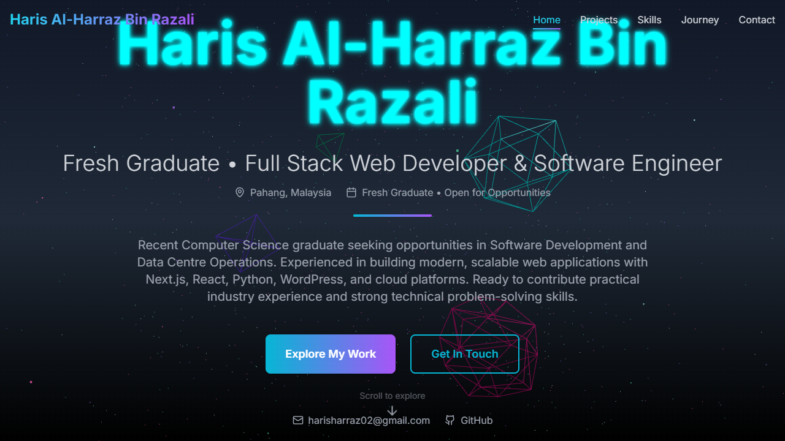

---

### 2. COSMOS — Solar System & Space Mission Explorer

- **Live Website:** https://cosmos-explorer-prz.pages.dev
- **Repository:** [risterz/cosmos-explorer](https://github.com/risterz/cosmos-explorer)
- **Hosted on:** Cloudflare Pages

A real-time WebGL Solar System and spaceflight exhibition built with React, TypeScript, Three.js, React Three Fiber, and GSAP. Features procedural planetary surface synthesis, an instanced 1,100-body asteroid belt, dual educational and astronomical distance scales, and a synchronized mission timeline from Sputnik 1 onward.

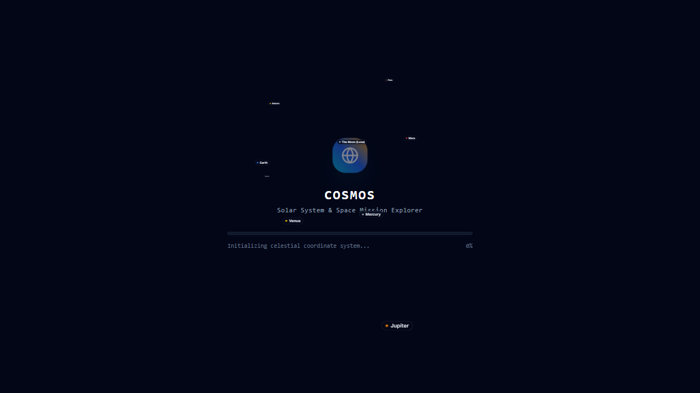

---

### 3. DONUTVERSE

- **Live Website:** https://donutverse.pages.dev
- **Repository:** [risterz/donutverse](https://github.com/risterz/donutverse)
- **Hosted on:** Cloudflare Pages

An editorial artisan donut storefront crafted with React 18, TypeScript, Tailwind CSS, GSAP, and Framer Motion. Includes a real-time procedural Three.js 3D glaze atelier with live flavor switching, a filterable 6-flavor menu, and a slide-over shopping bag supporting the `SWEET15` promo code.

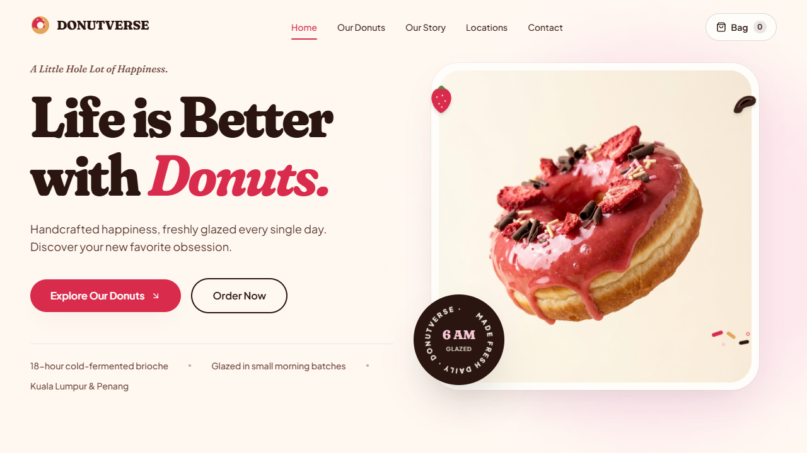

---

### 4. Email Dot Generator

- **Live Website:** https://gmail-dot-generator.netlify.app
- **Repository:** [risterz/email-dot-generator](https://github.com/risterz/email-dot-generator)
- **Hosted on:** Netlify

A client-side utility that generates Gmail dot-notation username variations instantly inside a responsive glassmorphism interface. Supports one-click individual copying, bulk copy-all, and toast feedback with zero backend dependencies.

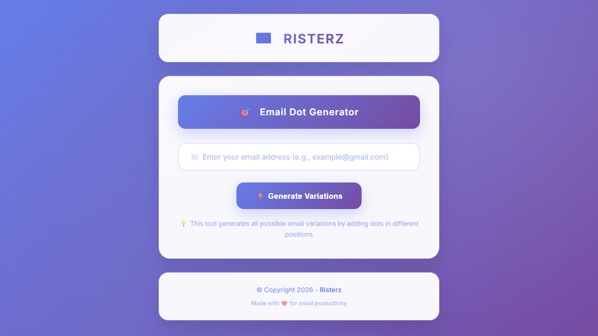

---

### 5. Ember & Olive

- **Live Website:** https://ember-olive-6v6.pages.dev
- **Repository:** [risterz/ember-olive](https://github.com/risterz/ember-olive)
- **Hosted on:** Cloudflare Pages

A Mediterranean wood-fired gastronomy showcase built with React 19, TypeScript, Tailwind CSS v4, Lenis smooth scroll, and GSAP ScrollTrigger. Features atmospheric editorial typography, parallax depth, chef spotlight storytelling, and an interactive menu drawer with sommelier pairings.

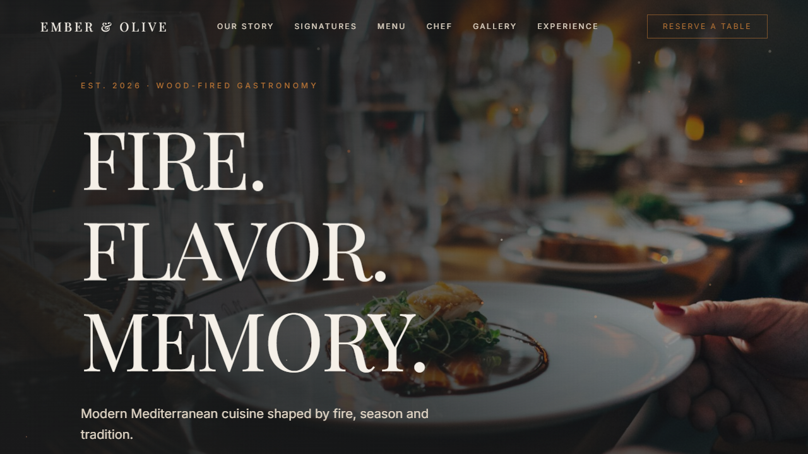

---

### 6. Gemini Web Interface

- **Live Website:** https://gemini-crack.onrender.com
- **Repository:** [risterz/gemini-web-ui](https://github.com/risterz/gemini-web-ui)
- **Hosted on:** Render

A stateless neo-brutalist web UI for Google Gemini AI backed by Python, Flask, Gunicorn, and `gemini-webapi`. Provides fast multimodal chat with image upload support and an Image Studio prompt workflow without persistent chat history overhead.

> **Note:** Hosted on Render free tier, so initial requests after inactivity may take 30–50 seconds for cold-start wake-up.

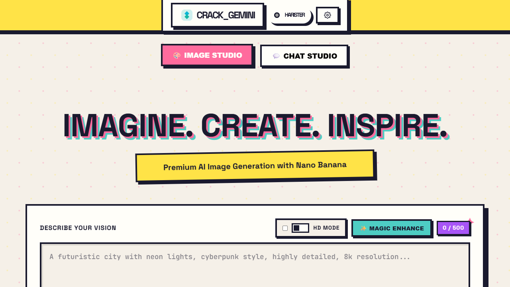

---

### 7. HIV Atlas

- **Live Website:** https://hiv-atlas.pages.dev
- **Repository:** [risterz/hiv-atlas](https://github.com/risterz/hiv-atlas)
- **Hosted on:** Cloudflare Pages

A stigma-free, plain-language HIV education guide and interactive 3D HIV-1 virion explorer built with React 19, Three.js, and Vite. Combines six guided learning chapters, transmission and testing tools, and a geometric cutaway 3D virion model.

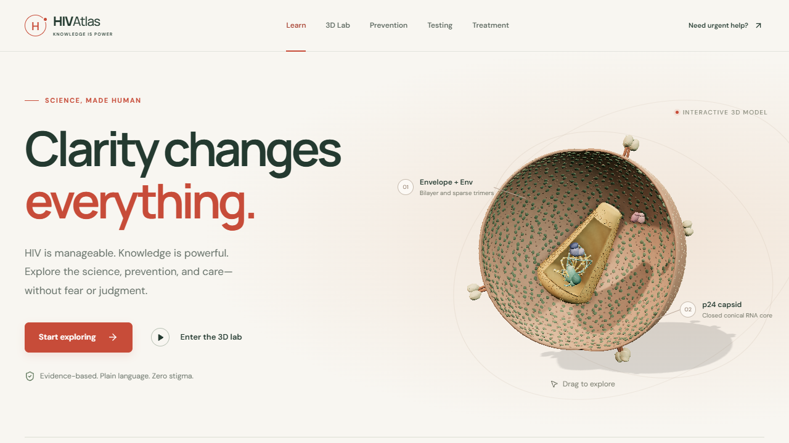

---

### 8. HIV Molecular Lab 3D

- **Live Website:** https://hiv-molecular-lab-3d.pages.dev
- **Repository:** [risterz/hiv-molecular-lab-3d](https://github.com/risterz/hiv-molecular-lab-3d)
- **Hosted on:** Cloudflare Pages

A 100% procedural WebGL virology and molecular biology laboratory built with React, TypeScript, Three.js, and Tailwind CSS. Generates B-DNA double helices, virion envelopes, cutaway enzyme cores, and reverse-transcription/NRTI chain-termination simulations purely from math meshes without external `.gltf` assets.

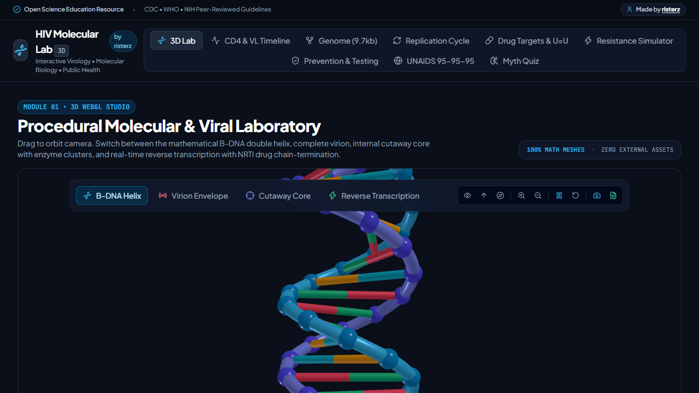

---

### 9. KAFA Sirah

- **Live Website:** https://kafa-sirah.vercel.app
- **Repository:** [risterz/kafa-sirah](https://github.com/risterz/kafa-sirah)
- **Hosted on:** Vercel

An interactive Islamic Sirah learning web application designed for young students (`Tahun 1` to `Tahun 5+`), built with Next.js, TypeScript, Tailwind CSS, and Framer Motion. Organizes lessons by grade level alongside interactive quizzes (`Kuiz`) and achievement tracking (`Pencapaian`).

---

### 10. KeyThock 3D

- **Live Website:** https://keythock.pages.dev
- **Repository:** [risterz/keythock](https://github.com/risterz/keythock)
- **Hosted on:** Cloudflare Pages

An interactive 3D mechanical keyboard customizer, acoustic simulator, and typing playground built with React Three Fiber, Three.js, and procedural Web Audio API synthesis. Supports switching keyboard form factors (`60%` to `80% TKL`), switch types (`Holy Panda`, `Gateron Yellow`, `Cherry MX Blue`, `Topre`), acoustic mods (`Tape Mod`, `PE Foam`), plate materials, and an exploded 3D teardown slider.

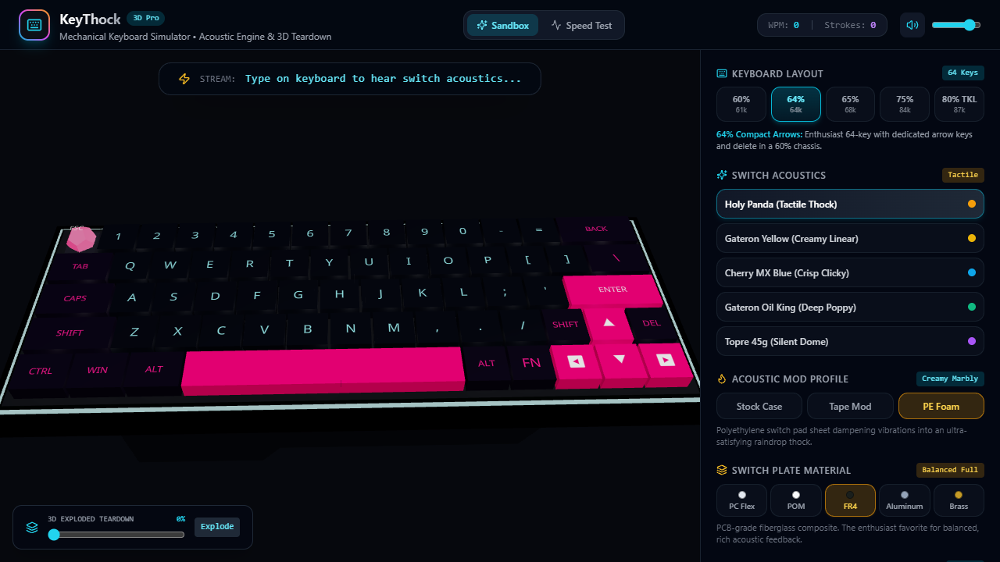

---

### 11. SonicShift (MP4 to MP3 Converter)

- **Live Website:** https://sonicshift-mp3.pages.dev
- **Repository:** [risterz/mp4-to-mp3-converter](https://github.com/risterz/mp4-to-mp3-converter)
- **Hosted on:** Cloudflare Pages

A 100% client-side MP4-to-MP3 audio extractor built with React 19, TypeScript, Tailwind CSS v4, and `ffmpeg.wasm`. Processes video files locally inside browser Web Workers with selectable studio bitrates and zero remote file uploads.

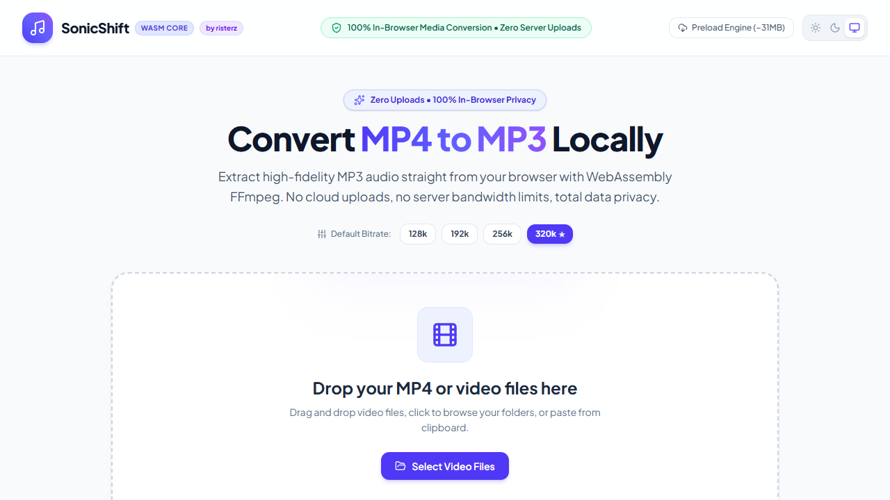

---

### 12. NEOMARKET

- **Live Website:** https://neomarket-1v5.pages.dev
- **Repository:** [risterz/neomarket](https://github.com/risterz/neomarket)
- **Hosted on:** Cloudflare Pages

A modern dark-editorial e-commerce storefront template built with React 19 and Vite 6. Implements live search, category filters, shareable product variants, a `localStorage`-backed wishlist and order history, promo code discounts, and an accessible demo checkout flow.

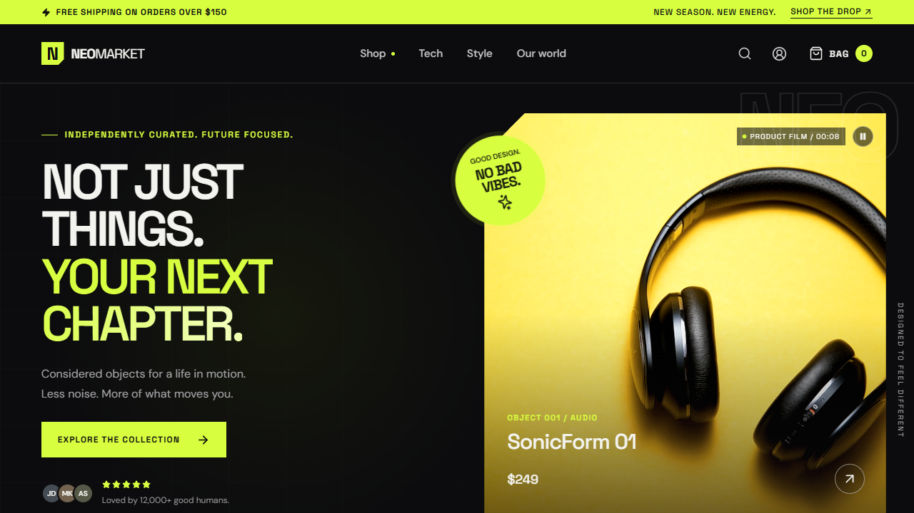

---

### 13. Papercraft PDF

- **Live Website:** https://papercraft-pdf.pages.dev
- **Repository:** [risterz/papercraft-pdf](https://github.com/risterz/papercraft-pdf)
- **Hosted on:** Cloudflare Pages

A neobrutalist, offline-capable PDF utility workshop powered by React 19, TypeScript, Tailwind CSS v4, `pdf-lib`, `pdfjs-dist`, and `jszip`. Supports merging PDFs, image-to-PDF and PDF-to-image conversion, page organization, splitting, watermarking, compression, and password protection completely in browser memory.

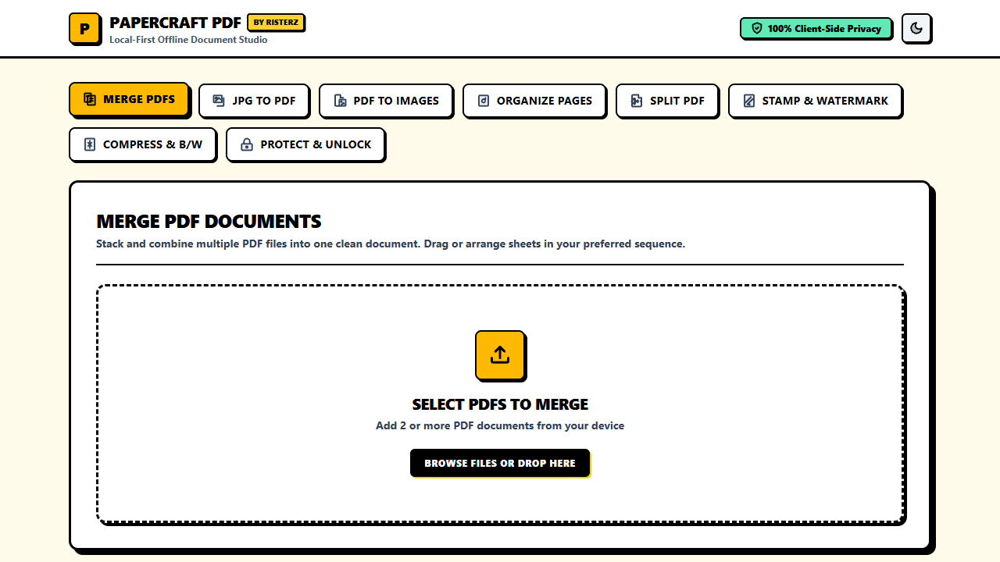

---

### 14. PixelVault

- **Live Website:** https://pixelvault-30v.pages.dev
- **Repository:** [risterz/pixelvault](https://github.com/risterz/pixelvault)
- **Hosted on:** Cloudflare Pages

A privacy-focused client-side image steganography tool built with Next.js 16, Tailwind CSS, the WebCrypto API, and HTML5 Canvas. Encrypts secret messages with PBKDF2 (200,000 iterations) and AES-256-GCM before embedding them into PNG/JPG/WebP images via LSB pixel encoding or lossless tail-append.

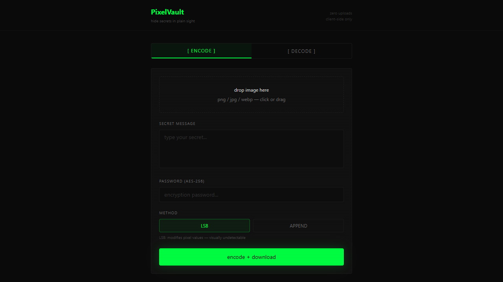

---

### 15. RoomForge 3D

- **Live Website:** https://roomforge-3d.pages.dev
- **Repository:** [risterz/RoomForge-3D](https://github.com/risterz/RoomForge-3D)
- **Hosted on:** Cloudflare Pages

A private, browser-based 3D interior room planner built with React 19, TypeScript, Three.js, and React Three Fiber. Lets users switch between 3D orbit and top-down 2D plan views, browse a procedural furniture catalog, customize finishes, and save designs locally.

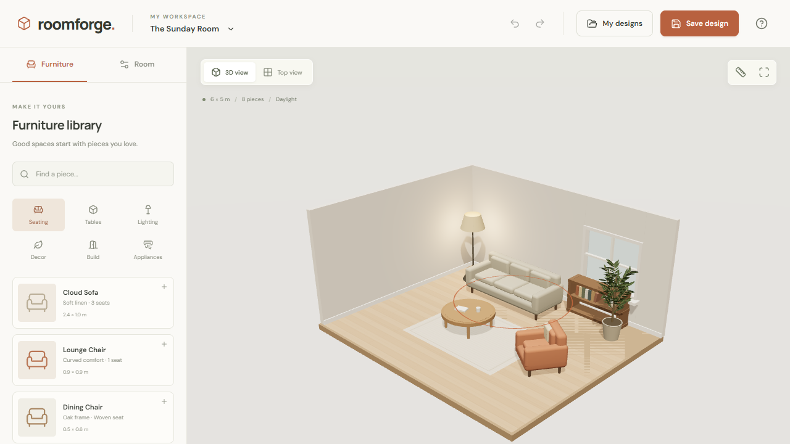

---

### 16. Saukass

- **Live Website:** https://risterz.github.io/saukazz/
- **Repository:** [risterz/saukazz](https://github.com/risterz/saukazz)
- **Hosted on:** GitHub Pages

A static multi-page sneaker and apparel e-commerce storefront template (`Volta`, `Thunder`, `Vamos`, `Beta` product lines) built with vanilla HTML, CSS, and JavaScript, featuring category pages, cart, and checkout pages.

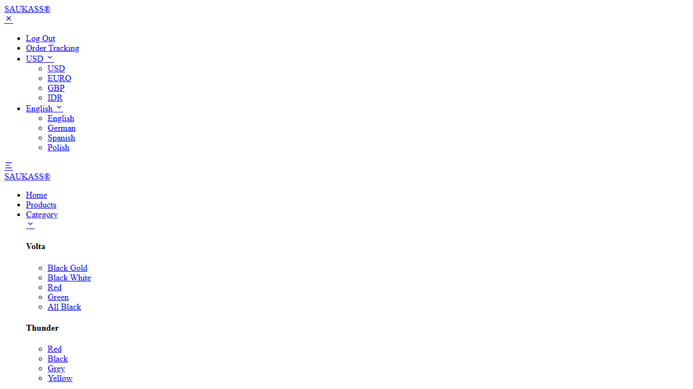

---

### 17. Shuffle Puzzle

- **Live Website:** https://shuffle-puzzle.harisharraz02.workers.dev/
- **Repository:** [risterz/shuffle-puzzle](https://github.com/risterz/shuffle-puzzle)
- **Hosted on:** Cloudflare Workers (+ D1 Leaderboard)

A responsive sliding-puzzle game built with vanilla HTML, CSS, and JavaScript, served from a Cloudflare Worker backed by a Cloudflare D1 database for ranked online leaderboards. Supports `3×3`, `4×4`, and `5×5` grids, number and custom-photo modes, light/dark themes, and persistent local state.

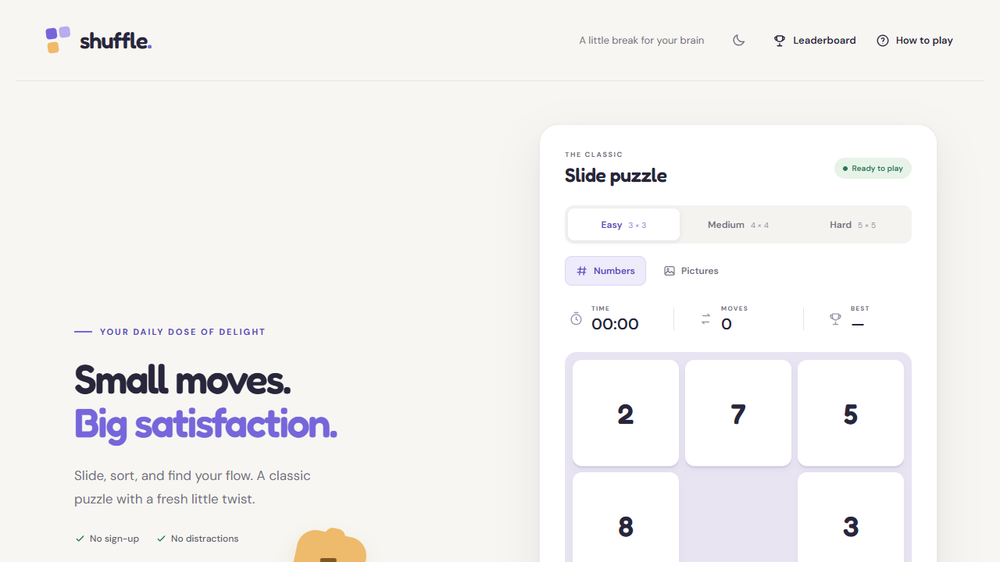

---

### 18. Synthwave CSS Generator

- **Live Website:** https://synthwavecssgen.netlify.app
- **Repository:** [risterz/synthwave-css-generator](https://github.com/risterz/synthwave-css-generator)
- **Hosted on:** Netlify

An interactive retro-futuristic neon UI generator built with React and `styled-components`. Provides live sliders and pickers for glow intensity, borders, typography, CRT scan lines, and synthwave grids, exporting copy-ready CSS or `styled-components` code for buttons, text, cards, and inputs.

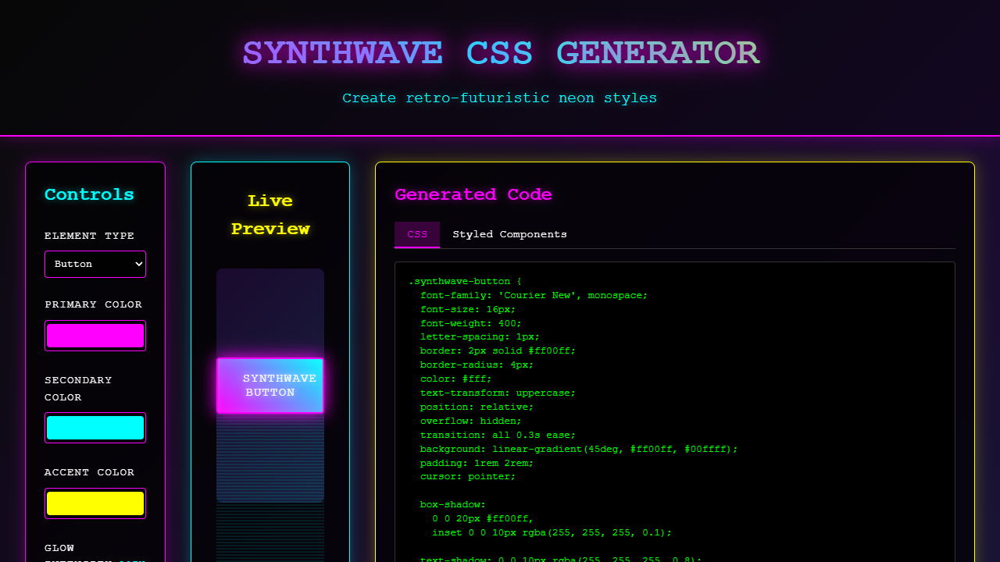

---

### 19. UNO Card Game

- **Live Website:** https://uno-card-game-335.pages.dev
- **Backend Service:** https://uno-multiplayer-backend-en4e.onrender.com (Render — Node.js + Socket.IO)
- **Repository:** [risterz/uno-card-game](https://github.com/risterz/uno-card-game)
- **Hosted on:** Cloudflare Pages + Render

A full-featured online multiplayer and single-player UNO card game built with React 19, TypeScript, Vite, Motion, and Socket.IO. Includes both the Classic Tournament Deck and a custom 54-illustration Halloween Collector's Deck, AI bots, custom background audio, and an authoritative Node/Socket.IO multiplayer backend.

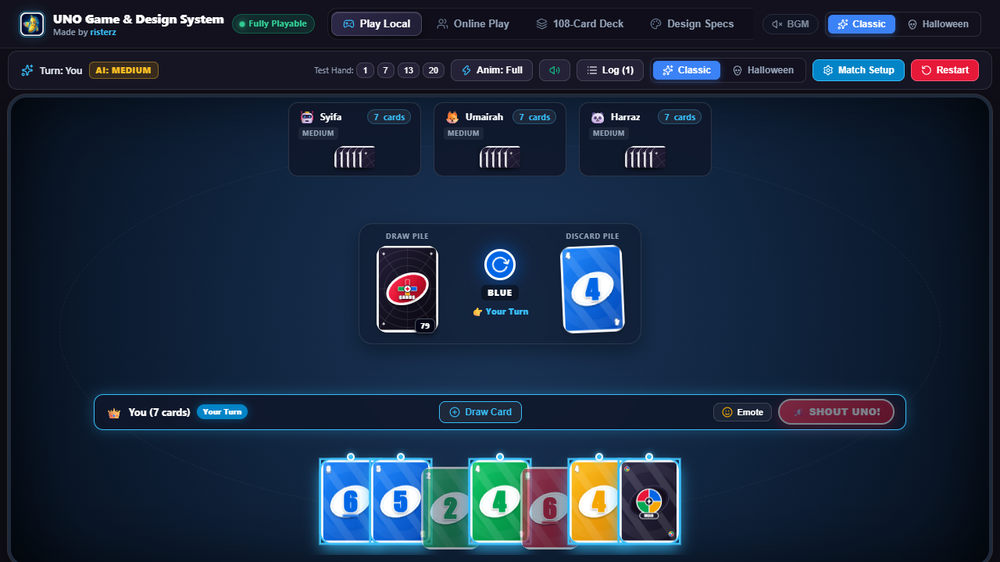

---

### 20. Windows 98 Emulator

- **Live Website:** https://windows98-emulator.pages.dev
- **Repository:** [risterz/windows98-emulator](https://github.com/risterz/windows98-emulator)
- **Hosted on:** Cloudflare Pages

A nostalgic browser recreation of the Windows 98 desktop built with Next.js, React, and TypeScript. Features draggable/resizable windows, a working Start Menu and taskbar, system apps (Notepad, Calculator, Paint, Internet Explorer, Control Panel, File Explorer), and classic games including Snake, Minesweeper, and Solitaire.

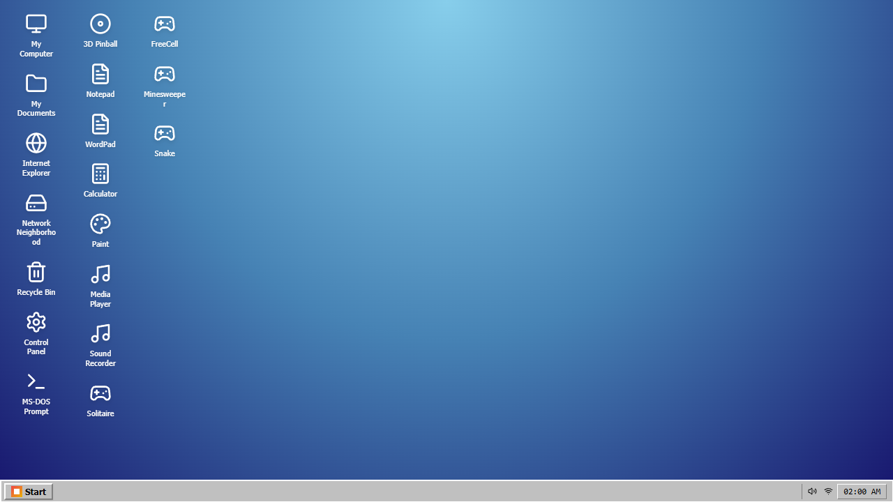

---

### 21. Brawl Arena

- **Live Website:** https://brawl-arena.harisharraz02.workers.dev
- **Repository:** [risterz/brawl-arena](https://github.com/risterz/brawl-arena)
- **Hosted on:** Cloudflare Workers (+ Durable Objects WebSockets)

A fast-paced 3D 3v3 real-time multiplayer arena brawler built with Three.js, TypeScript workspaces, Vite, and Cloudflare Durable Objects. Features 7 custom-rigged 3D brawlers with smooth skeletal animations and emissive shaders, Gem Grab and Brawl Ball modes across 3 symmetric destructible arenas, tactical A* bots for solo play, and cross-platform PC/mobile controls.

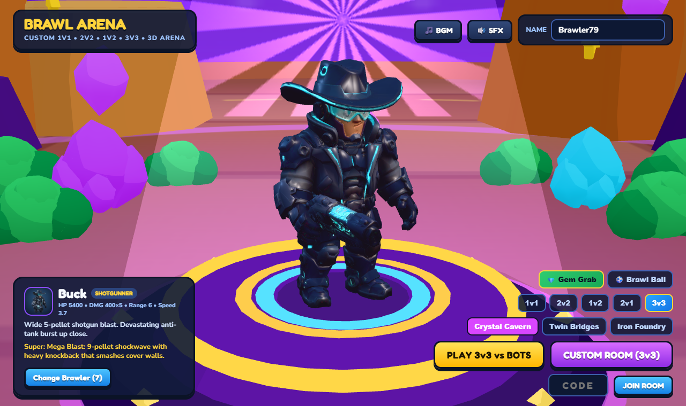

---

### 22. VELA — Donut V Architectural Showcase

- **Live Website:** https://vela-atelier.pages.dev
- **Repository:** [risterz/vela-atelier](https://github.com/risterz/vela-atelier)
- **Hosted on:** Cloudflare Pages

A zero-framework architectural luxury patisserie showcase built with vanilla ES modules, raw WebGL1 GLSL shaders, Lenis smooth scroll, parametric 3D SVG CAD wireframes, and a deterministic 25-plate headless Three.js PBR studio renderer in ~27 KB gzipped. Features a real-time cursor-driven ping-pong fluid sprinkle reveal, 12-dot SDF blooming mark, 6-act scroll choreography, holdout-occluded interactive glaze dipping studio, and full SPA checkout.

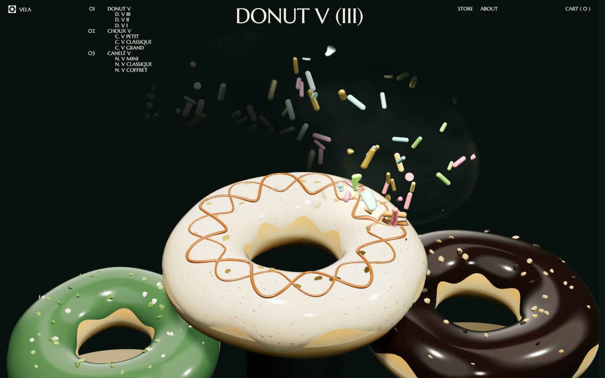
